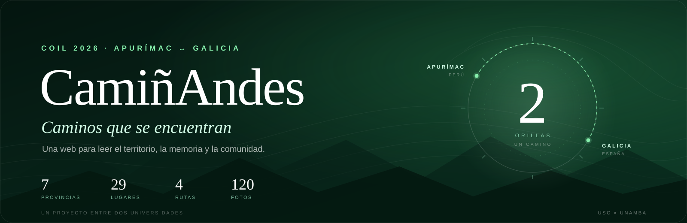
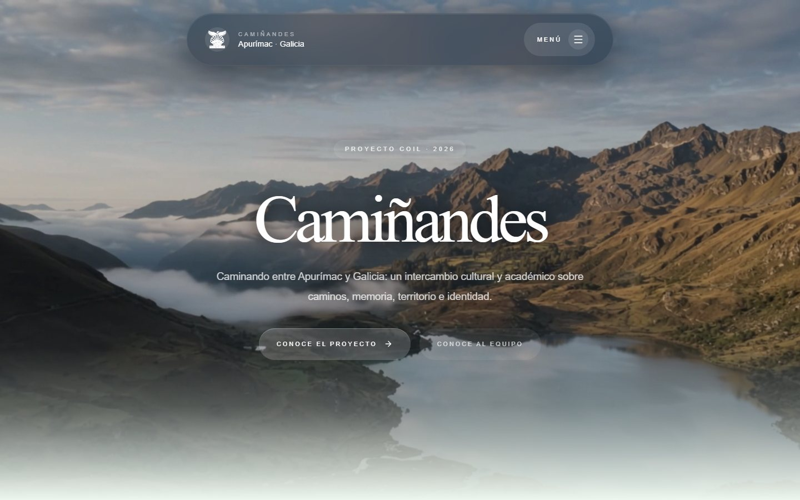
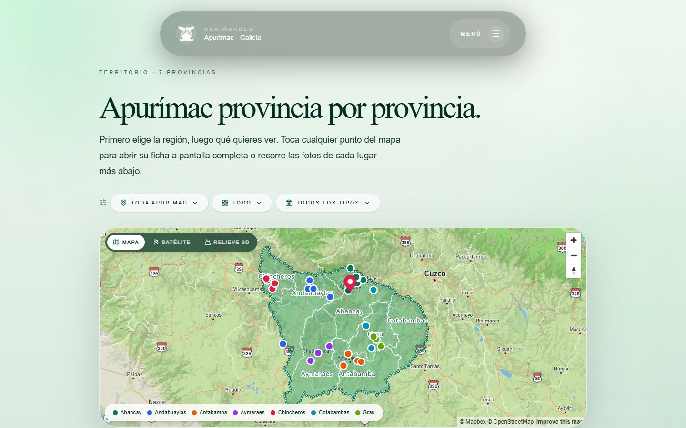
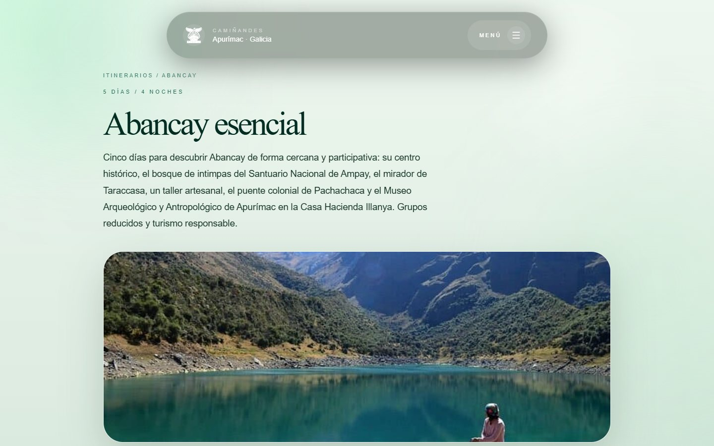

<p align="center">
  
</p>

<p align="center">
  <a href="https://nextjs.org/"></a>
  <a href="https://react.dev/"></a>
  <a href="https://www.typescriptlang.org/"></a>
  <a href="https://tailwindcss.com/"></a>
  <a href="https://www.mapbox.com/"></a>
  
</p>
<p align="center">
  <strong>Del Camino de Santiago a los caminos andinos.</strong><br />
  Una web para leer el territorio, la memoria y la comunidad entre Apurímac y Galicia.
</p>

---

> **CamiñAndes** es un proyecto COIL entre la Universidade de Santiago de Compostela (Galicia, España) y la Universidad Nacional Micaela Bastidas de Apurímac (Perú). Reúne **7 provincias**, **29 lugares**, **4 itinerarios** y **120 fotografías** en una experiencia web hecha para perderse y volver a mirar.

## 🌿 La idea

Caminar no es solo desplazarse: es leer un paisaje, escuchar una historia y reconocer a quienes lo habitan. **CamiñAndes** nace de esa idea y la convierte en un archivo vivo que compara dos formas de caminar el mundo: el Camino de Santiago y los caminos andinos de Apurímac.

La web está pensada como un mapa que se puede recorrer de muchas maneras: desde el mapa interactivo de las siete provincias hasta el detalle de cada ruta, cada lugar y cada relato.

## 🧭 Un mapa de la web

| Ruta | Sección | Qué vas a encontrar |
|:---|:---|:---|
| `/` | **Inicio** | Portada, mapa interactivo y accesos a todo el proyecto. |
| `/provincias/` | **Provincias** | Las 7 provincias, sus 29 lugares, filtros por tipo de atractivo, fichas de gastronomía, agricultura y vestimenta, y galerías de fotos. |
| `/itinerarios/` | **Itinerarios** | 4 rutas culturales con cronograma día por día, recomendaciones antes de viajar, enlaces al mapa y video. |
| `/proyecto/` | **Proyecto** | Objetivos, enfoque COIL y metodología de trabajo. |
| `/contacto/` | **Nosotros** | El equipo, las dos universidades, la historia del proyecto y los canales de contacto. |
| `/blog/` | **Blog** | Avances, hallazgos y relatos del proceso. |

## ✨ Lo que hace especial al sitio

- **Un mapa que se siente.** Mapbox GL dibuja las siete provincias de Apurímac con marcadores por tipo de lugar, filtros y fichas a pantalla completa.
- **Rutas que se leen.** Cada itinerario tiene un cronograma claro, horarios orientativos, consejos y un mapa de los lugares que lo componen.
- **La fotografía como archivo.** Más de un centenar de imágenes organizadas por provincia y por lugar, con carruseles y paneles de detalle.
- **Video en cada itinerario.** El reproductor detecta si el archivo existe y muestra la ruta; si aún no está disponible, aparece un “Próximamente” cuidado.
- **Territorio, no solo paisaje.** Gastronomía, agricultura, vestimenta y memoria oral acompañan a los atractivos turísticos.
- **Una identidad visual propia.** Verde profundo, Instrument Serif, Manrope, animaciones suaves y una lectura cómoda en móvil y escritorio.

## 🖼️ Una mirada

| Inicio | Provincias | Itinerarios |
|:---:|:---:|:---:|
| [](docs/preview-inicio.jpg) | [](docs/preview-provincias.jpg) | [](docs/preview-itinerario.jpg) |

## 🛠️ Bajo el capó

| Pieza | Tecnología | Para qué |
|:---|:---|:---|
| Framework | **Next.js 16** (App Router) | Rutas, páginas estáticas y exportación. |
| UI | **React 19 + TypeScript** | Componentes, estados y datos tipados. |
| Estilos | **Tailwind CSS 4** | Sistema visual, responsive y utilidades. |
| Mapa | **Mapbox GL JS** | Mapa interactivo de provincias y lugares. |
| Movimiento | **GSAP + ScrollTrigger** | Apariciones, transiciones y detalles de scroll. |
| Iconos | **Lucide + Morphicons** | Iconografía coherente y animada. |
| Contenido | **TypeScript + assets locales** | Provincias, rutas, fotos y videos sin CMS. |
| Salida | **Export estático** | `out/` listo para cualquier hosting compartido. |

> **Nota técnica:** el build usa Webpack (`next build --webpack`) porque el CSS de `mapbox-gl` rompe el pipeline de Turbopack. El modo desarrollo sí puede usar Turbopack.

## 🚀 Levantarlo en local

### 1. Clona el repositorio

```bash
git clone https://github.com/dimasII/Cami-andes-web.git
cd Cami-andes-web
```

### 2. Instala las dependencias

```bash
npm install
```

### 3. Configura Mapbox

Crea un archivo `.env.local` a partir de `.env.example` y añade tu token público:

```env
NEXT_PUBLIC_MAPBOX_TOKEN=tu_token_de_mapbox
```

Puedes crear un token en [Mapbox Access Tokens](https://account.mapbox.com/access-tokens/).

### 4. Arranca el proyecto

```bash
npm run dev
```

Abre [http://localhost:3000](http://localhost:3000).

## 📦 Build y despliegue

```bash
npm run build
```

El sitio se genera en `out/`. Para publicarlo en Hostinger, sube **el contenido** de `out/` a `public_html/` (incluida la carpeta `_next/`), no la carpeta `out/` ni el código fuente. Si actualizas una versión anterior, reemplaza todo el contenido y limpia la caché del navegador; el `.htaccess` incluido se encarga del `DirectoryIndex`, la caché y la compresión.

El proyecto es **100% estático**: no necesita Node.js en el servidor. El token de Mapbox es público, así que conviene restringirlo por dominio desde el panel de Mapbox.

Para probar el build en local:

```bash
npx serve out
```

## 🗂️ Dónde tocar cada cosa

| Quiero cambiar… | Archivo o carpeta |
|:---|:---|
| Provincias, lugares, coordenadas, fotos, gastronomía, agricultura y vestimenta | `src/lib/provincias.ts` |
| Itinerarios, días, horarios, videos y enlaces al mapa | `src/lib/itinerarios.ts` |
| Fotos de un lugar | `public/img/provincias/<provincia>/<lugar>/` |
| Video de una ruta | `public/video/itinerarios/<slug>.mp4` |
| Estilos globales y animaciones | `src/app/globals.css` |
| Banner y capturas del README | `docs/` |

Los videos se activan solos cuando el archivo existe. Si falta, la página muestra un estado “Próximamente” sin romperse.

## 👥 Equipo

| Apurímac · UNAMBA | Galicia · USC |
|:---|:---|
| Dimas Rogelio Prada Huamani | Sofía Pérez Cobas |
| Giordano Jhosser Ticona Ortiz | Fabiola Pulleiro Iglesias |
| | Noa Martínez Sanjurjo |

[Universidad Nacional Micaela Bastidas de Apurímac](https://www.unamba.edu.pe/) · [Universidade de Santiago de Compostela](https://www.usc.gal/)

## 💚 Créditos y cuidado

Las fotografías, relatos y datos de territorio se comparten con fines educativos y culturales. Si eres autor/a de una imagen o formas parte de una comunidad y quieres ajustar un crédito, corregir un dato o retirar un contenido, abre un [issue](https://github.com/dimasII/Cami-andes-web/issues) o escríbenos a través de la sección **Nosotros** del sitio.

---

<p align="center">
  <em>“Del Camino de Santiago a los caminos andinos: camino, memoria y comunidad a ambos lados del Atlántico.”</em>
</p>

<p align="center">
  Hecho con cariño entre Apurímac y Galicia · <strong>COIL 2026</strong>
</p>

<p align="center">
  Si el proyecto te gusta, una ⭐ ayuda a que más gente lo encuentre.
</p>
